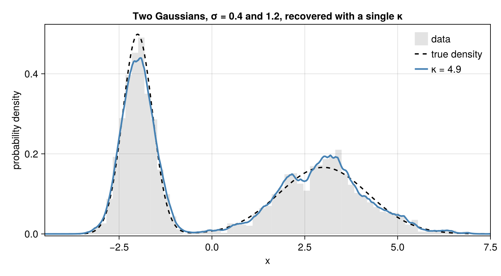
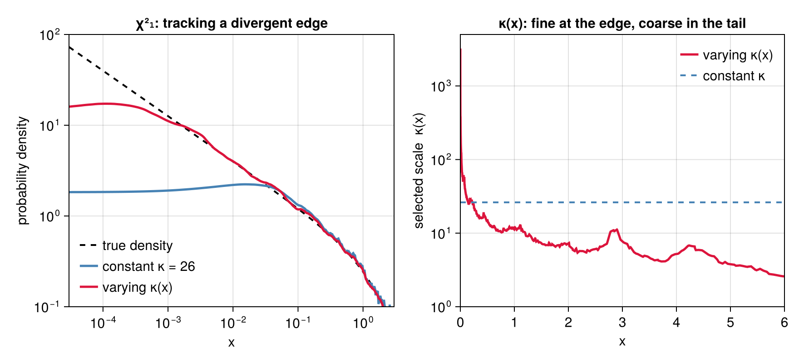
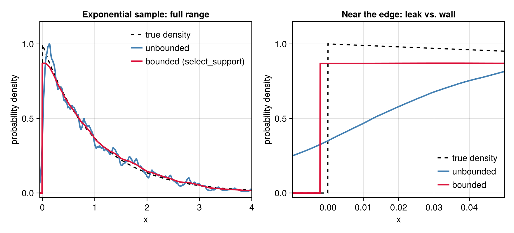

```@meta
CurrentModule = PenalizedDensity
```

# Tutorial

This walkthrough fits a bimodal distribution, chooses the smoothing scale, and tests
candidate models against the data.

## A worked example

Consider an equal-weight mixture of two Gaussians, a narrow one (``\sigma=0.4``) centered at ``x=-2`` and a broad one (``\sigma=1.2``) at ``x=3``. First draw some samples from this distribution:

```@example tutorial
using Random

Random.seed!(42)
comps = [(w=0.5, μ=-2.0, σ=0.4), (w=0.5, μ=3.0, σ=1.2)]
truepdf(x) = sum(c.w * exp(-((x - c.μ) / c.σ)^2 / 2) / (c.σ * sqrt(2π)) for c in comps)

N = 2000
xs = [rand() < comps[1].w ? comps[1].μ + comps[1].σ * randn() :
                            comps[2].μ + comps[2].σ * randn() for _ in 1:N]
nothing # hide
```

To estimate the density from the points `xs`, first select a smoothing scale and then fit:

```@example tutorial
using PenalizedDensity

κ = select_kappa(xs)                    # recommended scale (KL cross-validation)
d = DensityEstimate(xs, κ)              # fit at the recommended scale
nothing # hide
```

`κ` determines the amount of smoothing: away from the data, the amplitude of the estimate
decays over a length `1/κ`. `d(x)` returns the estimated density at a single point `x`.
Plotting the estimate against the true density:

```julia
using CairoMakie                              # for plotting
g = range(-4.5, 7.5; length = 800)
lines(g, truepdf.(g); linestyle = :dash, label = "true density")
lines!(g, d.(g); label = "κ = $(round(κ, digits=1))")
axislegend()
```



A single scale resolves both the narrow and the broad component. `κ` sets the resolution
rather than the width of any component: ``1/\kappa`` is smaller than either component's
``\sigma``, so the estimate resolves features of any larger width, and those widths come
from the data.

## Choosing the smoothing scale

The recommended selector is [`select_kappa`](@ref), which minimizes a likelihood
(Kullback–Leibler) cross-validation score:

```@example tutorial
κ_kl = select_kappa(xs)                     # likelihood cross-validation
```

Its score is the leave-one-out log-likelihood ``-\tfrac1N\sum_i \ln \hat
Q_{-i}(x_i)``, where ``\hat Q_{-i}(x_i)`` is an estimate at the point ``x_i``
formed from all points *except* ``x_i`` itself. This score is an estimate of
``\mathrm{KL}(Q \,\|\, \hat Q_\kappa)`` up to a constant, and is the natural criterion for
this estimator, whose action is itself a log-likelihood. Each leave-one-out density comes
from a one-step expansion of the fit, so no refitting is needed. The selected scale grows
like ``N^{1/5}``.

The score assumes a *continuous* underlying density, in which no two observations coincide.
If more than 1% of the observations repeat another value, `select_kappa` throws an
`ArgumentError` unless you say what the repeats mean with the `resolution` keyword. For values
rounded to a lattice of spacing `δ`, `select_kappa(x; resolution = δ)` selects the scale for
[`IntervalDensityEstimate`](@ref)`(x, κ; resolution = δ)`, treating each observation as its
rounding interval. `resolution = 0` declares the repeats to be exact points; each held-out term
then leaves out every observation at the held-out value (`holdout = :location`), so the score
does not reward spikes at the repeated values.

## Comparing selection criteria

`select_kappa` is the default criterion. The alternatives below are `public` but not exported,
and are provided for comparing criteria on your own data. Each comes as a selector together
with a function that evaluates its score at a given ``\kappa``:

| criterion | selector | score at `κ` |
|:--|:--|:--|
| likelihood cross-validation (KLCV) | [`select_kappa`](@ref) | [`klcv`](@ref) |
| least-squares cross-validation (LSCV) | [`select_kappa_lscv`](@ref) | [`lscv`](@ref) |
| minimum sensitivity | [`select_kappa_sensitivity`](@ref) | [`action_sensitivity`](@ref) |

Evaluating a score over a range of ``\kappa`` shows how sharply its minimum is defined:

```@example tutorial
using PenalizedDensity: klcv, lscv, action_sensitivity, select_kappa_lscv, select_kappa_sensitivity
κs = exp.(range(log(0.5), log(50); length = 41))
scores = [klcv(xs, κ) for κ in κs]
κs[argmin(scores)], κ_kl                     # best grid point and the selected scale
```

Least-squares cross-validation minimizes an unbiased estimate, up to a constant, of the
integrated squared error ``\int(\hat Q_\kappa - Q)^2``, i.e. it targets minimum mean integrated
squared error (MISE):

```@example tutorial
κ_lscv = select_kappa_lscv(xs)
```

To leading order it selects the same ``\kappa \propto N^{1/5}`` as `select_kappa`. Across a
range of test densities, `select_kappa` tracks the error-optimal scale more closely (see
`benchmarks/`) and is cheaper, because it needs no ``\int \hat Q^2`` term. LSCV has no
interval form, so for rounded data use `select_kappa` with `resolution`.

[`select_kappa_sensitivity`](@ref) targets the *information* in the data rather than the
error. It returns the point of *minimum sensitivity*, where [`action_sensitivity`](@ref)
``= |dS/d\ln\kappa|`` is smallest. The derivative is computed analytically, so the result has
none of the noise that finite differences of the action would introduce.

```@example tutorial
κ_ms = select_kappa_sensitivity(xs)
```

On smooth densities, minimum sensitivity over-resolves: its scale grows faster with ``N`` than
the error-optimal ``N^{1/5}``. It takes no `support`,
because the entropy asymptotics it relies on are derived for the unbounded line.

## Letting the scale vary across the data

Every selector above returns one ``\kappa`` for the whole line, and a single scale is a
compromise: fine enough to resolve the peaks, coarse enough to avoid noise in the tails.
On a smooth density the compromise costs little. When the density is irregular, with a
divergent or discontinuous edge, a kink, or a heavy tail, no constant ``\kappa`` is good
everywhere.

[`select_kappa`](@ref)`(x, Adaptive())` lets the scale vary with ``x``: ``\kappa(x)`` is large
where the data resolve fine detail and small where they do not.

As an example, take a ``\chi^2_1`` sample, whose density diverges as ``x^{-1/2}`` at the origin:

```@example adaptive
using PenalizedDensity, Random, Statistics

Random.seed!(7)
z = randn(4000) .^ 2                  # χ²₁: the density diverges at x = 0

κ_const = select_kappa(z)           # one scale everywhere
κ_var = select_kappa(z, Adaptive())   # a scale that varies with x
```

The adaptive selector returns a callable ``\kappa(x)`` (here a [`WindowScale`](@ref), described
below), which [`DensityEstimate`](@ref) accepts in place of a number:

```@example adaptive
d_const = DensityEstimate(z, κ_const)
d_var = DensityEstimate(z, κ_var)
```

In the figure below, the left panel shows the true density (dashed) and the two estimates
`d_const` and `d_var`; the right panel shows `κ_const` and `κ_var` as functions of position.



The estimate with constant `κ` departs from the power law below ``x \approx 3\times 10^{-2}``;
the adaptive one follows it to about hundredfold-smaller `x` (typically fewer than one hundred
points fall within `[0, 1e-3]`). The improvement can be measured on held-out data: the
difference in mean log-likelihood of a fresh sample estimates the reduction in KL divergence,
in nats per sample:

```@example adaptive
ztest = randn(4000) .^ 2
loglik(d) = mean(logdensity.(d, ztest))

(constant = round(loglik(d_const); digits = 3),
 varying = round(loglik(d_var); digits = 3),
 gain = round(loglik(d_var) - loglik(d_const); digits = 3))
```

Two families of varying scales compete with the constant one. All are compared by the
leave-one-out KL score that [`select_kappa`](@ref) minimizes, generalized to a varying scale
and still evaluated in closed form in ``O(N)``.

The first is a *plug-in* of the variable-bandwidth kind; Abramson's square-root law,
[*Ann. Statist.* **10**, 1217 (1982)](https://doi.org/10.1214/aos/1176345986), is the
``\alpha = 1/2`` member. A pilot fit ``\hat p`` at the constant scale supplies the shape, and
the scale is drawn from the family ``\kappa(x) = c\,(\hat p(x)/\bar g)^{\alpha}`` (``\bar g``
the geometric mean of ``\hat p`` over the sample), an [`AdaptiveScale`](@ref); both ``c`` and the
exponent ``\alpha`` are chosen by the score. This family can only refine the scale where the
density is high.

The second, the *window rule*, asks how far from ``x`` the sample extends before it shows
structure: ``\hat h(x)`` is the smallest half-width at which the points in
``[x - \hat h, x + \hat h]`` show a slope or a curvature (their first or second moment departs
from that of a uniform spread by a set number of standard deviations), and
``\kappa(x) = c\,(1/\hat h(x))^{\gamma}`` with ``\gamma`` fixed and ``c`` chosen by the score.
It refines the scale wherever the density changes over a short distance, regardless of its
height: at a divergent edge, as here, and also at a narrow bump beside a broad mode, which the
power family cannot resolve:

```@example adaptive
rng = Xoshiro(7)
xb = [rand(rng) < 0.8 ? randn(rng) : 3 + 0.15randn(rng) for _ in 1:2000]   # a narrow bump at 3
κb = select_kappa(xb, Adaptive())
round(κb(3.0) / κb(0.0); digits = 1)    # finer at the bump than at the broad mode
```

Because the window is estimated from the same sample that the score holds points out of, the
score slightly favors the window candidate. A penalty offsets this (see [`WindowRule`](@ref))
before the candidate is compared with the power family's choice.

The constant scale, the ``\alpha = 0`` member of the power family, competes in the same
comparison; when it scores best, the selector returns a plain number rather than a callable.
`window = nothing` leaves out the window rule; the power family must then beat the constant
scale by more than one standard error of the gain in score (the keyword `nse` sets the
multiple). On uniform data, where ``\hat p^\alpha`` has no variation to exploit, the result is
the constant:

```@example adaptive
select_kappa(rand(2000), Adaptive(; window=nothing)) isa Real
```

## Fitting a hard edge

A varying scale sharpens resolution near a feature, but the amplitude is still built from
exponential tails that extend over all of ``\mathbb{R}``. When the true density has an edge
(zero on one side, nonzero on the other), no choice of ``\kappa(x)`` reproduces it exactly:
some of the fit's mass always lies beyond the edge. The `support` keyword of
[`DensityEstimate`](@ref) instead imposes a natural (Neumann) boundary condition at a finite
endpoint, and [`select_support`](@ref) chooses that endpoint from the data, the same way the
other selectors choose ``\kappa``.

As an example, take a sample from the standard exponential distribution, whose density jumps
from `0` to `1` at ``x=0``:

```@example bounded
using PenalizedDensity, Random, Statistics

Random.seed!(11)
N = 1500
x = -log.(1 .- rand(N))                 # exponential(1): a jump edge at x = 0

κ_const = select_kappa(x)
d_unbounded = DensityEstimate(x, κ_const)

(κ = round(κ_const; digits=1), leaked_mass = round(cdf(d_unbounded, 0.0); digits=4))
```

`leaked_mass` is [`cdf`](@ref)`(d_unbounded, 0.0)`: about one percent of the fit's mass lies
below `x = 0`, where the true density is zero. [`select_support`](@ref) finds a left boundary
(a "wall") that removes it:

```@example bounded
r = select_support(x)
d_bounded = DensityEstimate(x, r.κ; support = r.support)

(wall = round(r.support[1]; digits=5), κ = round(r.κ; digits=2), cdf_at_wall = cdf(d_bounded, r.support[1]))
```

`cdf_at_wall` is exactly `0`, because no mass lies outside the support. The selected scale is
also about a fifth of `κ_const`: without a wall, a large `κ` is needed to keep the leaked mass
small. (The search re-optimizes `κ` at every boundary candidate; see [`select_support`](@ref).)
The wall lies close to the data:

```@example bounded
xs = sort(x)
spacing = (xs[10] - xs[1]) / 9      # mean spacing of the 10 points nearest the edge
gap = minimum(x) - r.support[1]
round(gap / spacing; digits=2)
```

This is the search's lower limit: `select_support` never places a wall closer to the data than
five mean spacings of the points nearest the edge. A closer boundary reflects the nearest
points back onto themselves and inflates their leave-one-out likelihood on any sample, whether
or not it has an edge. On a sample with a hard edge, the search usually stops at this limit, as
it does here. A smooth sample has no edge, and the search returns the unbounded candidate:

```@example bounded
xg = randn(1500)
rg = select_support(xg)

(support = rg.support, κ_matches_plain_selection = rg.κ === select_kappa(xg))
```

The support is `(-Inf, Inf)`, and the returned `κ` is identical to `select_kappa(xg)`: the
unbounded candidate always competes, and here it wins.

To combine a boundary with a varying scale, pass the chosen
`support` on to [`select_kappa`](@ref)`(x, Adaptive())` so that its own search runs on the bounded domain.
The result is whichever kind of scale wins: a number, an [`AdaptiveScale`](@ref) or a
[`WindowScale`](@ref).

```@example bounded
κ_composed = select_kappa(x, Adaptive(); support=r.support)
d_composed = DensityEstimate(x, κ_composed; support = r.support)

κ_composed
```

To compare the three fits, score them on independent data from the same distribution:

```@example bounded
xtest = -log.(1 .- rand(N))
loglik(d) = mean(logdensity.(d, xtest))

(unbounded = round(loglik(d_unbounded); digits=3),
 bounded = round(loglik(d_bounded); digits=3),
 bounded_and_adaptive = round(loglik(d_composed); digits=3))
```

The wall accounts for nearly all of the gain. The exponential interior has little
irregularity left for a varying scale to resolve, and the two bounded scores agree to within
the sampling noise of a fresh `N`-point sample. The figure below shows the fits near the edge:
the unbounded estimate (blue) extends below `x = 0`, where the true density (dashed) is zero,
while the bounded estimate (crimson) has zero slope at the wall:



## Goodness of fit

Because the estimate is a likelihood fit, you can ask how well a specific model distribution
describes the data. Using the fit `d` from above, [`chisq`](@ref) is a
robust, binning-free ``\chi^2`` (the squared Hellinger distance between a trial density and
the data):

```@example tutorial
wrong(x) = exp(-((x - 0.5) / 2.5)^2 / 2) / (2.5 * sqrt(2π))   # a single broad Gaussian

(correct = round(chisq(d, truepdf); digits = 1),
 incorrect = round(chisq(d, wrong); digits = 1))
```

The true mixture yields a far smaller ``\chi^2`` than the mismatched single Gaussian.
To judge significance, build the reference distribution of ``\chi^2`` for the fit with
[`ChisqReference`](@ref); by default it is evaluated as the finite-``N`` generalized
chi-squared law. [`pvalue`](@ref) converts a statistic into a p-value under it, and one
reference serves any number of trial densities:

```@example tutorial
ref = ChisqReference(d)
(p_correct = round(pvalue(ref, chisq(d, truepdf)); digits = 3),
 p_incorrect = round(pvalue(ref, chisq(d, wrong)); digits = 6))
```

The single Gaussian is decisively rejected; the true mixture is not. [`chisq_pdf`](@ref) and
[`chisq_ccdf`](@ref) give the reference density and upper-tail probability, and
[`mean`](@ref Statistics.mean)`(ref)` its exact mean:

```@example tutorial
round(mean(ref); digits = 2)
```

The reference law is exact for the Gaussian fluctuation field of the Laplace approximation
about the fit, and `method = :exact` (the default) evaluates it at finite ``N``, without a
large-``N`` limit. See [`ChisqReference`](@ref) for details.

Each evaluation of the exact law is a numerical integral (Imhof inversion) that takes tens of
milliseconds. `method = :largeN` instead uses the closed-form inverse-Gaussian (Wald) shape
of the paper's large-``N`` limit, with mean `mean(ref)`. It takes microseconds, which makes
testing many trial densities against one fit much cheaper, and because it matches the exact
mean it tracks the exact tail closely:

```@example tutorial
(exact = round(pvalue(ref, chisq(d, truepdf)); digits = 3),
 largeN = round(pvalue(ref, chisq(d, truepdf); method = :largeN); digits = 3))
```

Both methods apply equally to fits with a varying scale or a finite `support`, at the same
``O(N)`` cost.

## Entropy and negentropy

Because the fit is a smooth density, its entropy can be computed in closed form.
[`entropy`](@ref) is a plug-in estimate of the differential entropy ``H(Q) = -\int Q \ln Q``,
and [`negentropy`](@ref) is the entropy deficit relative to the Gaussian of the same mean and
variance. Negentropy measures how non-Gaussian the density is: it is zero for a Gaussian and
positive otherwise.

```@example tutorial
(H = round(entropy(d); digits = 3), J = round(negentropy(d); digits = 3))
```

The bimodal fit is strongly non-Gaussian, so its negentropy is well above zero. `negentropy`
is invariant to shifting and rescaling the data (with the matching ``\kappa \mapsto \kappa/|a|``),
so it depends only on shape.

Both functions also accept a second argument of held-out points, data that did not enter the
fit. Then ``\ln \hat Q`` is evaluated at those points, and the Gaussian reference uses the
held-out sample's variance:

```@example tutorial
xeval = [rand() < comps[1].w ? comps[1].μ + comps[1].σ * randn() :
                               comps[2].μ + comps[2].σ * randn() for _ in 1:1000]
(H = round(entropy(d, xeval); digits = 3), J = round(negentropy(d, xeval); digits = 3))
```

The held-out negentropy is close to the in-sample value here because the fit generalizes
well. In general the in-sample value is inflated, because the fit concentrates density on its
own sample; the held-out form avoids this, for the same reason that [`select_kappa`](@ref)
cross-validates.

[`logdensity`](@ref) returns ``\ln \hat Q`` directly. Far from the data, where ``2\kappa``
times the distance to the nearest node exceeds about 745, `d(x)` underflows to zero and
`log(d(x))` gives `-Inf`, but `logdensity(d, x)` remains finite and accurate.

Two functions give derivatives of the log density:
[`logdensity_eval_gradient`](@ref) gives ``\partial \ln \hat Q(y)/\partial y`` in closed form,
and [`logdensity_node_gradient`](@ref) gives the gradient of a weighted sum of log densities
with respect to the node positions, in ``O(N + M)`` for ``N`` nodes and ``M`` evaluation
points.
